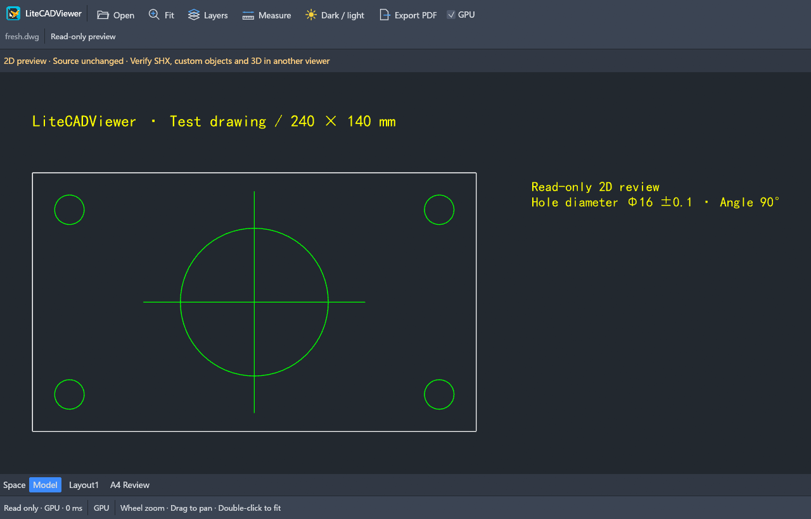

<p align="center"></p>

# LiteCADViewer

**A lightweight, read-only 2D CAD viewer with GPU rendering.**

An independent desktop application for reviewing CAD drawings, maintained by **Dennis-pan ([@Dennis-pan-x](https://github.com/Dennis-pan-x))**. Built from CADCraft's open-source reading and rendering core, without its design editor, editing engine or constraint solver.

**[Download Windows x64 preview](https://github.com/Dennis-pan-x/LiteCADViewer/releases/latest)** · [Usage](docs/usage.md) · [Provenance](docs/provenance.md)



## Features

- Open DWG, DXF and DWT drawings, including drag-and-drop.
- Hardware GPU rendering with four-sample antialiasing and cached geometry during navigation; CPU fallback available.
- Fit to drawing, filter layers, toggle visibility temporarily, and switch model/layout spaces.
- Measure between two freely picked points and export the current space to a new PDF.
- English-only interface. Source drawings are opened read-only; there is no entity editing, drawing save or autosave.

Extract the Windows package and run **LiteCADViewer.exe**. The current release is a Windows x64 portable preview; runtime behavior on other systems has not been validated.

## Scope and limits

This is a **2D preview**, not a complete CAD design application. SHX/big fonts, proxy/custom objects, complex layouts and 3D may differ from full CAD software. Distance measurement has no object snapping. GPU rendering does not accelerate DWG parsing or improve file-format compatibility. Export refuses existing filenames, including source hard links.

Synthetic DXF/DWG tests exercise behavior and input preservation; DWG generated by CADCraft is a same-core round trip, not an independent fidelity oracle. See [validation](docs/validation.md).

## Build

Use Rust stable (validated with Rust 1.99.1) and the Windows C++ build tools on Windows. Cargo.lock pins dependencies; the optional craft-fonts checkout is not required.

```sh
cargo build --locked --release -p litecad-viewer
cargo run --locked --release -p litecad-viewer -- drawing.dwg
cargo fmt --all -- --check
cargo clippy --locked --workspace --all-targets -- -D warnings
cargo test --locked --workspace
```

On memory-constrained Windows machines set `CARGO_BUILD_JOBS=1`. [scripts/package-windows.ps1](scripts/package-windows.ps1) builds a portable ZIP and SHA-256 checksums.
Run [scripts/check.ps1](scripts/check.ps1) for the complete local formatting, lint and workspace-test gate.

## Project structure

- `apps/litecad-viewer`: the standalone viewer frontend and Windows product resources, version 0.1.1.
- `crates/`: nine required CADCraft-derived geometry, document, file and rendering libraries, retaining their original names/version and notices.
- `assets/viewer-icon`: the approved origami-bird application icon.

This repository is the independent **LiteCADViewer application**. The separate [CADCraft component PR #1606](https://github.com/storytold/cadcraft/pull/1606) is related upstream technical work, not the product's home.

## License and community

MIT OR Apache-2.0; original ArtCraft/CADCraft copyrights and notices are retained. New viewer contributions: Dennis-pan. The unmodified acadrust dependency is MPL-2.0. See [NOTICE](NOTICE), [ATTRIBUTION.md](ATTRIBUTION.md), and [third-party licenses](THIRD-PARTY-LICENSES.txt).

Independent community project derived from CADCraft. It is not an official ArtCraft product; launcher or website inclusion requires the maintainers' approval. No restricted ArtCraft marks or proprietary CAD resources are bundled.
